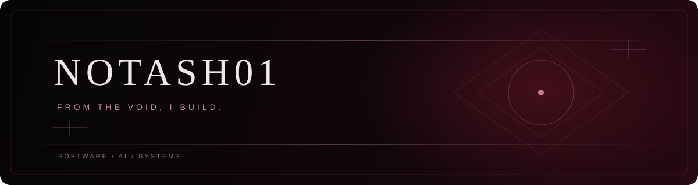

<!-- Profile README for NotAsh01 -->

  

  <h1>NOTASH01</h1>
  
<strong>SOFTWARE · AI · AUTOMATION · MINECRAFT SYSTEMS</strong>

  
Building ambitious systems, shaping digital experiences, and learning by shipping.

  <a href="https://github.com/NotAsh01?tab=repositories">EXPLORE REPOSITORIES</a>
  &nbsp;·&nbsp;
  <a href="https://github.com/NotAsh01?tab=projects">PROJECTS</a>
  &nbsp;·&nbsp;
  <a href="https://github.com/NotAsh01?tab=followers">FOLLOW</a>

---

### / PROFILE

I'm a developer interested in the intersection of software engineering, AI, automation, and game systems. I like taking ideas from a rough concept to a structured project — planning the architecture, building the core, and refining the experience along the way.

My current work spans Python applications, Java-based Minecraft systems, and minimal web design.

### / FEATURED PROJECTS

<table>
  <tr>
    <td width="50%" valign="top">
      <h3>◈ NOCTRYX</h3>
      
A dark-fantasy Minecraft SkyBlock remake with RPG progression, custom creatures, regions, islands, and minions.

      JAVA 21 · PAPER · SQLITE · PRIVATE REPOSITORY
    </td>
    <td width="50%" valign="top">
      <h3>◈ NOCTRYX AI</h3>
      
A personal AI workspace with a FastAPI foundation, local conversation storage, tasks, reminders, approvals, and a dashboard.

      PYTHON · FASTAPI · SQLITE · PRIVATE REPOSITORY
    </td>
  </tr>
  <tr>
    <td width="50%" valign="top">
      <h3>◈ HORI SKYBLOCK</h3>
      
A classic-era SkyBlock recreation focused on the early progression loop and the feel of the pre-Dungeons era.

      JAVA · MINECRAFT · PRIVATE REPOSITORY
    </td>
    <td width="50%" valign="top">
      <h3>◈ NOIR // VOID</h3>
      
A dark, minimal editorial web experience built around restrained typography, a monogram, and clean responsive layout.

      HTML · CSS · PUBLIC REPOSITORY 
      <a href="https://github.com/NotAsh01/noir-void-site">VIEW PROJECT ↗</a>
    </td>
  </tr>
</table>

### / ADDITIONAL BUILDS

| Project | Direction | Repository |
|:--|:--|:--|
| **Hori's Remake** | Legacy Minecraft 1.8.8 plugin codebase | Private |
| **Ash Block** | Java 8 / Spigot 1.8.8 SkyBlock plugin project | Private |
| **Hypixel Hub Core Remake** | Minecraft hub-core foundation and systems | Private |

Private projects are listed for portfolio context and are not publicly accessible.

### / TOOLKIT

  

### / ENGINEERING NOTES

- **Build with intent:** keep architecture understandable and systems separated.
- **Be honest about status:** distinguish implemented features from planned ideas.
- **Automate the repeatable:** use tooling and CI to make development more consistent.
- **Respect boundaries:** make permissions, credentials, and consequential actions explicit.

### / GITHUB ACTIVITY

  
  

  FROM THE VOID, I BUILD.

